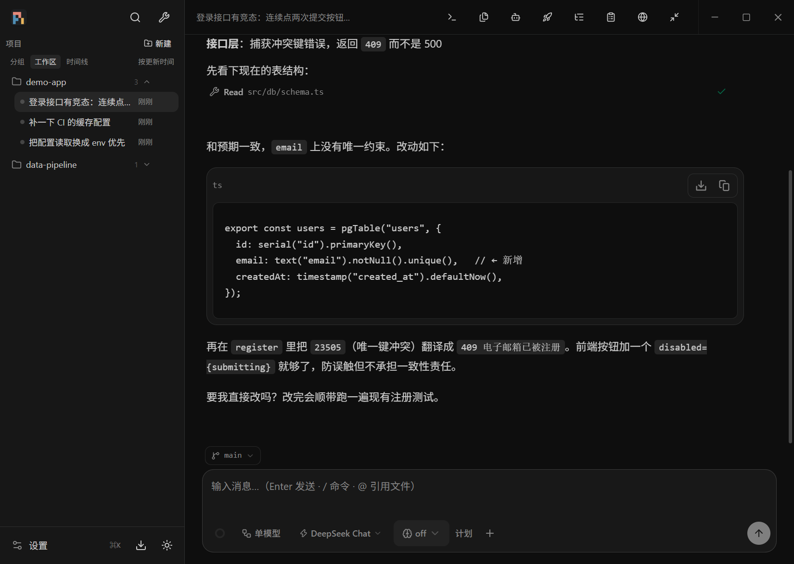
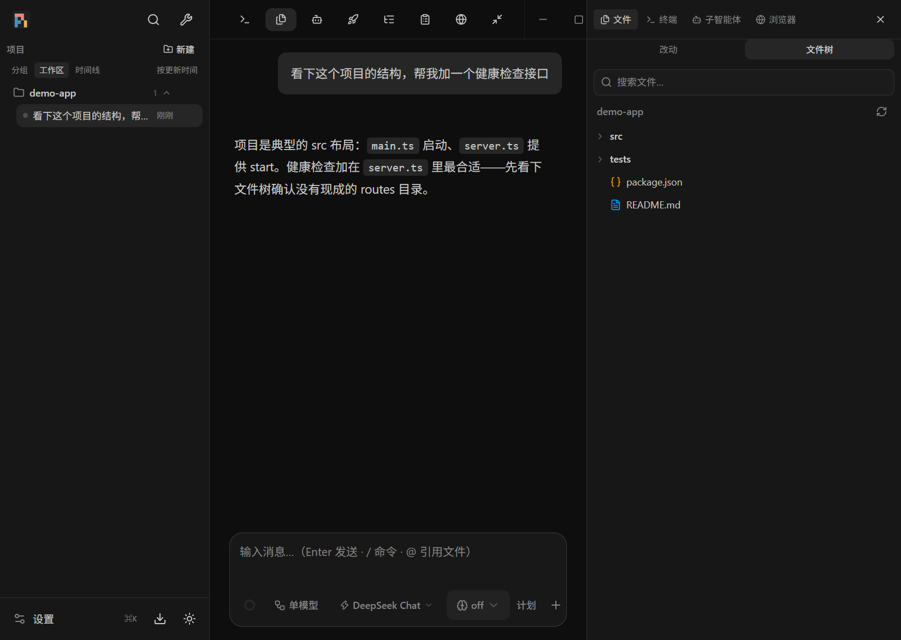
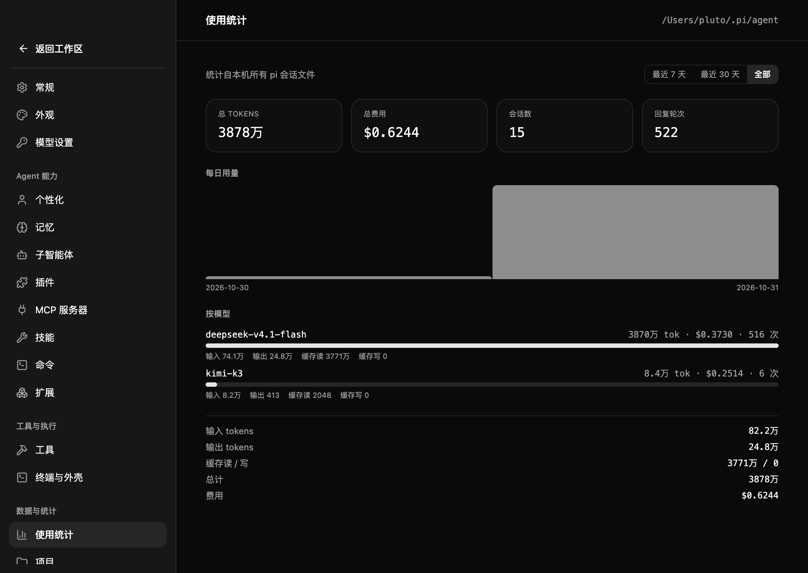

<div align="center">


# Pi Desktop

**pi coding agent 的桌面客户端** —— Electron 外壳 + React 界面，后端直接跑 `pi --mode rpc`。

不自研 agent：pi 是唯一事实来源，外壳只负责编排、缓存与交互。

[](https://github.com/Plutothj/pi-next-desktop/releases/latest)
[](https://github.com/Plutothj/pi-next-desktop/actions/workflows/ci.yml)
[](https://github.com/Plutothj/pi-next-desktop/releases/latest)

</div>



## 特性

### 项目与多会话
- **项目树**：把常用文件夹加入左侧项目列表（名称 + 目录选择），每个项目一组、可折叠，会话按更新时间排列
- 每个项目行悬停即可 **＋ 新建会话** / **× 移除**（移除不删会话文件）；支持项目 / 日期分组 / 时间线三种视图
- **多会话并行**：每个会话一个独立 pi 进程，切换会话不打断正在运行的回合；后台会话空闲 10 分钟自动回收，切回时按需重启
- 会话管理：重命名、删除（二次确认）、复制会话 ID、**导出 HTML**、Finder 显示
- **首启新手引导**：全新安装自动弹出功能速览，之后可从 设置 → 版本 → 重看引导 随时回看

### 对话体验
- 流式渲染：思考块与工具调用压缩为 **单行日志**（图标 + 名称 + 参数预览 + 状态），点击展开详情/差异；助手消息占满列宽，流式输出不抖动
- 代码高亮、diff 渲染、Mermaid 图表、图片附件缩放查看
- 消息级操作：复制、**Fork / 编辑重发**（用户消息之前分叉并预填输入框；任意助手回复文件级分叉）
- **失败回合错误横幅**：限流 / 网络断 / 模型暂停等错误直接显示在转录里，不再静默

### 输入框
- 模型选择器与思考等级**内嵌 footer**（锚定弹层，非模态）
- `Enter` 发送、`Shift+Enter` 换行、流式中 `Enter` 排队、`Option+Enter` 立即插入（steer）
- `/` 命令、`@` 文件引用、**计划模式**（产出 markdown 方案文档）
- **附件解析**：粘贴 / 拖拽发送图片（原生 image part）、txt / pdf / docx / xlsx / zip（自动解析为文本内联）
- 上下文用量环（tokens / 费用 / 缓存命中率）实时刷新

### 模型与供应商
- **供应商预设**一键填：DeepSeek / 智谱 / Kimi / 通义千问 / OpenRouter / Ollama，也支持自定义 baseUrl + 请求头
- **获取模型列表**：从供应商端点拉取，自动合并 [models.dev](https://models.dev) 元数据（上下文窗口 / 价格 / 推理档位）
- **连接测试**：保存前一键验证 baseUrl + 密钥 + 网络
- **模型参数可编辑**：点模型行的上下文徽章，展开修改上下文 / 最大输出 / 每 Mtok 价格（支持 `200k`、`1m` 写法）
- **pi-desktop/auto 虚拟模型**：low 自动路由到最便宜、high 到最强，工具调用回合粘性跟随
- **双模型模式**：规划模型只出方案 → 自动切执行模型 → 结束恢复；方案自动落盘到 `<项目>/.pi/plans/`

### 工程能力
- **变更面板**：AI 改过的文件一目了然，逐文件看 diff（新增/删除行数）、单文件撤销、全部撤销（二次确认）
- **并行任务板**：把整段任务丢给后台 agent 并行跑，随时点开完整对话视图追问 / steer / 中止
- 右侧面板：文件树（git 状态着色）、终端、子智能体、内置浏览器
- **定时任务**：每日 HH:MM 触发并行 agent（如"每天 9 点拉取依赖更新"）
- **Git 分支 chip**：当前分支、脏状态、ahead/behind，点击切换分支
- **后台任务**：`pi-bg` CLI + 本地桥（Unix socket / Windows 命名管道），agent 可主动把长任务丢到终端面板
- **全局用量统计**：跨全部会话按模型/按天聚合 tokens、费用、调用次数，支持 7 天/30 天/全部筛选
- 扩展协议完整支持：`confirm` / `notify` / `setTitle` / `setStatus` / `setWidget` / `select` / `input` / `editor`
- ⌘K 命令面板（搜索任务/命令）、⌘N 新建会话、浅色/深色主题、4K 大屏界面缩放（档位 + 快捷键）、快捷键面板
- 诊断导出（版本、运行时、会话、任务快照 + 最近日志）

### 扩展生态
- **开箱即用**：首次启动自动离线安装 pi-memory（跨会话记忆）与 rpiv-ask-user-question（结构化提问）
- 自带 **todo 工具扩展**：任务拆解进度以 widget 卡片实时显示在输入框下方
- **插件市场**：浏览 / 搜索 / 一键安装 npm 上的 pi 扩展包，可按资源类型（扩展/技能/提示词/主题）启停
- codemode / MCP 工具支持：运行时外部依赖（jiti、quickjs 等）打包时自动 vendor，插件装上即能用

### 自包含运行时
- 安装包内置 **官方 Node** 与 **pi 运行时**，不依赖本机 node / pi 安装
- 独立配置目录 **`~/.pi-desktop/`**：`agent/`（配置、auth、会话、扩展）、`bin/pi-bg`、`terminal.sock`、`projects.json`
- 首次启动自动从 `~/.pi/agent` 迁移一次（配置、会话、扩展树），之后与 CLI 版 pi 互不干扰



## 安装

从 [Releases](https://github.com/Plutothj/pi-next-desktop/releases/latest) 下载：

| 平台 | 产物 |
|---|---|
| macOS (arm64) | `.dmg` / `.zip` |
| Windows (x64) | `.exe` 安装包 |
| Linux (x64) | `.AppImage` |

应用内 **检查更新**（侧边栏底部按钮或 ⌘K）支持自动更新。

**macOS 首次启动**：安装包为 ad-hoc 签名（无 Apple 开发者证书），从网络下载后 Gatekeeper 会拦截。任选一种方式打开：

```bash
# 推荐：移除下载隔离标记后直接打开
xattr -dr com.apple.quarantine /Applications/Pi.app && open /Applications/Pi.app
```

或：系统设置 → 隐私与安全性 → 安全性 →「仍要打开」。若提示「已损坏」且上述命令无效，请重新下载（旧版本缺少签名）。

**Windows 首次安装**：安装包未做代码签名，SmartScreen 会提示「Windows 已保护你的电脑」——点「更多信息」→「仍要运行」即可。任务栏图标若显示异常（图标缓存残留），重启一次资源管理器即可恢复。

## 开发

```bash
npm install

npm run dev        # 只启动 Vite
PI_DEV_URL=http://localhost:5173 npm run electron   # 日常开发：热更新模式
npm start          # 生产资源模式（构建 + 启动）
npm test           # node:test 冒烟（会话解析 / fork / 任务桥 / 扩展）
npx tsc --noEmit   # 类型检查（CI 强制 0 错误）
```

Electron 下载失败时（网络原因）：

```bash
ELECTRON_MIRROR=https://npmmirror.com/mirrors/electron/ node node_modules/electron/install.js
```

打包与发布：

```bash
npm run stage      # 准备运行时：pi bundle + 官方 Node（有缓存；NODE_MIRROR 可换镜像）
npm run dist       # 当前平台安装包（不发布）
npm run release    # 构建并发布到 GitHub Releases（CI 使用）
```

发布新版本（**不要手改 package.json 版本号**，lockfile 不会同步；`npm version` 会拒绝脏工作区，天然防漏提交）：

```bash
npm version patch -m "Bump version to %s"   # 改版本 + 独立提交 + 打 tag
git push --follow-tags                       # 推送即触发 release 工作流
```

`Release` 工作流构建三平台安装包，由单独的 publish job 统一上传（`latest*.yml` 供自动更新使用）。

### 环境变量

| 变量 | 作用 |
|---|---|
| `PI_DEV_URL` | 渲染层加载 Vite dev server（热更新） |
| `PI_DEBUG` | 启用 `pi:debugDialog` 调试扩展对话框、boot 轮询日志 |
| `PI_CLI` / `PI_NODE` | 覆盖 pi CLI / 解释器（开发时指向本地安装） |
| `PI_DESKTOP_HOME` | 覆盖 `~/.pi-desktop` 数据目录（测试隔离用） |
| `PI_AGENT_DIR` | 覆盖 agent 目录（默认 `<PI_DESKTOP_HOME>/agent`，E2E 用） |
| `NODE_MIRROR` | `npm run stage` 下载 Node 的镜像（默认 nodejs.org） |

### 运行时解析顺序

1. `process.resourcesPath/runtime/cli.js`（打包内置运行时，含 `bin/node`）
2. `$PI_CLI`
3. `~/.pi/agent/install/` 由 `current-version` 指向的版本；node 依次取托管安装、PATH、常见 Homebrew 路径

## 架构

```
┌──────────────── Electron 主进程 ────────────────┐
│ main.js           窗口/生命周期/扩展 UI 协议桥    │
│ session-pool.js   多会话进程池（每会话一进程）     │
│ pi-process.js     运行时解析、能力探测、RPC 子进程 │
│ sessions/projects 会话与项目（文件扫描 + 持久化）  │
│ agents/schedules  并行 agent 板 / 定时任务        │
│ git/tasks/workspace 分支、后台任务桥、文件树      │
│ config-ipc/diag/updater/usage  设置/诊断/更新/统计 │
└──────────────┬───────────────────┬──────────────┘
        IPC    │                   │ stdio JSONL
┌──────────────▼─────────┐   ┌─────▼─────────────────┐
│ React 渲染层            │   │ pi --mode rpc ×N      │
│ usePi 单一 reducer      │   │ （内置 Node + bundle） │
│ Chat/Composer/面板/设置  │   └─────┬─────────────────┘
└──────────────┬─────────┘         │ 子进程
               └──── pi-bg CLI ─────┴──▶ 终端面板任务表
```

- **pi 是唯一事实来源**：会话内容、模型状态、扩展协议都来自 RPC；外壳只做增量缓存与对账
- 主进程按职责拆分，IPC 统一经 `safeHandle`（参数校验 + 错误日志环）；渲染层单 reducer 承载事件流
- 跨平台：macOS/Linux 用 Unix socket 与 `$SHELL -lc`；Windows 用命名管道、`cmd.exe`、`taskkill /T`（已在 Windows 真机日常使用）

完整设计、RPC 命令表、IPC 通道表、调试与排错索引见 **[docs/DEVELOPMENT.md](docs/DEVELOPMENT.md)**。



## 数据目录

| 内容 | 位置 |
|---|---|
| pi 配置 / 会话 / 扩展 | `~/.pi-desktop/agent/`（`PI_CODING_AGENT_DIR`） |
| 项目列表、任务桥、pi-bg、定时任务 | `~/.pi-desktop/` |
| 主题 / 双模型配置 / 引导状态 | 应用 localStorage |

## 已知限制

- 安装包未做代码签名：macOS 走 ad-hoc（自动更新可能被 Squirrel 拒绝，会回退到 Releases 页）；Windows 触发 SmartScreen 提示（见安装节）
- 会话列表通过扫描 `~/.pi-desktop/agent/sessions` 生成（带 mtime 缓存）
- pi 的会话文件格式按 v3 校验；未知版本会拒绝文件级 fork 并提示升级
- 扩展的 `select/input/editor` 由输入框上方卡片处理；其他扩展 UI 方法按协议转发

## License

[MIT](LICENSE)

## 致谢

基于 [pi coding agent](https://github.com/earendil-works/pi-coding-agent) 构建；界面使用 Electron、React、Tailwind CSS、shadcn/ui、[Vercel AI Elements](https://ai-sdk.dev/elements)、Streamdown，新手引导使用 [driver.js](https://driverjs.com)。
